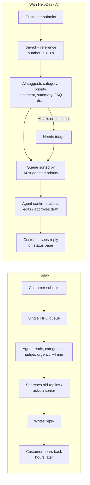

# Business Requirements Document — HelpDesk AI

| | |
| --- | --- |
| Version | 1.0 (draft for Gate 1) |
| Date | 2026-10-30 |
| Product owner | The user |
| Author | Claude Code (business analyst role) |
| Source | [BA interview notes](interview-notes.md) |
| Client | Fictional mid-size online retailer. All people, figures and data are fictional. |

Figures marked **assumed** come from the BA, were accepted by the product owner, and are not measured.

---

## 1. Executive summary

Support at the retailer is manual and depends on individual expertise. Every ticket is read, categorised
and prioritised by hand, and the right answer usually lives in a senior agent's head. As a result,
customers wait hours for acknowledgement, urgent problems queue behind routine questions, and new agents
take weeks to become productive. The new starters also slow down the seniors they keep asking.

HelpDesk AI makes three changes:
- Customers get a reference number instantly when they submit a ticket.
- Claude suggests a category, priority, sentiment and a short summary for each ticket, and drafts a
  reply grounded only in the retailer's FAQ.
- An agent reviews, edits and approves every reply before it's sent.

The AI never contacts a customer on its own, never changes a priority after its first suggestion, and
every AI suggestion is labelled, explained and can be overridden.

The MVP targets the web-form channel and is measured on:
- acknowledgement time
- how fast a new agent can handle a ticket
- how often AI drafts are approved with no or minor edits
- the quality of approved replies

It must also meet a hard guardrail: **zero urgent tickets missed by the AI**.

## 2. Business problem and current state

**Problem statement (product owner):** "Highly manual process and dependent on individual
knowledge/expertise level." The most costly effect is **slow onboarding**: know-how isn't written down,
so new agents take weeks to become useful.

**Current state (all assumed):**

| Fact | Value |
| --- | --- |
| Ticket volume | ~300 per day |
| Team | 8 agents (~2 new starters per quarter), 1 team lead |
| Channels | Web form and email (MVP covers the web form only) |
| Time to read, categorise and prioritise a ticket | ~4 min |
| Derived reading/routing load | ~37 tickets per agent per day → ~2.5 hrs per agent per day before writing any reply |
| Time to acknowledgement | ~3 hrs |
| Time to first response | ~6 hrs |

**Pain points:**
1. A single first-in-first-out queue: urgent tickets (wrongful charges, failed time-critical deliveries)
   wait behind "where's my order?" questions.
2. No acknowledgement until an agent opens the ticket.
3. Answers come from searching old replies or asking a senior, so quality and speed depend on who picks
   the ticket up.
4. New starters interrupt the seniors, which slows them down too (hidden cost).

## 3. Goals

| # | Goal |
| --- | --- |
| G1 | Faster acknowledgement and first response |
| G2 | New agents become productive sooner |
| G3 | Agents find the right, policy-consistent answer from the knowledge base in seconds |
| Guardrail | No urgent ticket is missed or deprioritised by the AI |

G3 was reworded in the interview from "better use of AI for retrieval" (a means) to an outcome. Urgent
handling is a pass/fail guardrail, not a goal to improve.

## 4. KPIs

| Goal | KPI | Baseline | Target | Target source | Measurable in this project? |
| --- | --- | --- | --- | --- | --- |
| G1 | Time to acknowledgement | ~3 hrs (assumed) | < 3 s | assumed | **Measured**: app logs |
| G1 | Time to first response | ~6 hrs (assumed) | < 1 hr | assumed | **Simulated** in UAT |
| G2 | Time for a new agent to handle a ticket | ~10 min (assumed) | ~2 min | product owner | **Measured in UAT**: new vs experienced agents |
| G2 | Weeks to full productivity | ~6 weeks (assumed) | ~3 weeks | assumed | **Not measurable**: expected outcome only |
| G3 | AI drafts approved with no or minor edits | n/a | ≥ 85% | product owner | **Measured**: edit tracking (US-06) |
| G3 | Triage accuracy (category + priority) | n/a | ≥ 85% | assumed | **Measured**: `/eval` |
| Guardrail | Urgent tickets missed by the AI | n/a | 0 | playbook | **Measured**: `/eval` |
| Counter-metric | Sampled approved replies that are correct and policy-consistent | n/a | ≥ 90% | product owner | **Measured**: lead/PO review of a sample |
| CX | Customer Effort Score ("How easy was it to get your issue handled?", 1–7) | n/a | set at UAT planning | — | **Measured in UAT** |
| CX | Customer reply rating, 1–5 CSAT (US-10) | n/a | set at UAT planning | — | **Measured** in-product |

**Why the counter-metric exists:** fast handling and high approval rates are also what rubber-stamping
looks like (automation bias, RAID R10). Reviewing a sample of approved replies for correctness checks
that the speed is real.

## 5. Stakeholders and users

| Stakeholder | Interest |
| --- | --- |
| Head of customer support (product owner) | Funds and signs off the project; owns goals and AI boundaries |
| Customers | Quick acknowledgement, a correct answer, a status they can check |
| Support agents (new and experienced) | Less sorting, trustworthy drafts, control over what's sent |
| Team lead | Visibility of volumes, AI performance and overrides |

Personas: **Sofia Martínez** (customer), **Daniel Kim** (new agent, primary), **Amara Okafor**
(experienced agent), **Priya Shah** (team lead). See [personas.md](personas.md).

## 6. Scope

### In scope: MVP
| Capability | Story |
| --- | --- |
| Ticket submission via web form | US-01 |
| Instant confirmation with reference number and status link | US-02 |
| AI triage: category, priority, sentiment, confidence, reason, long-ticket summary | US-03 |
| AI draft reply grounded in the FAQ | US-04 |
| Agent queue sorted by priority | US-05 |
| Agent edits/approves draft; confirms or overrides labels; overrides logged | US-06 |
| Customer status page via unguessable link | US-07 |
| Team-lead dashboard | US-08 |
| AI fallback: "Needs triage" | US-09 |
| Agent sign-in | US-12 |
| *(Should)* Customer rates the reply | US-10 |
| *(Could)* "Ask the knowledge base" for agents | US-11 |

### Out of scope: roadmap
| Item | Why it's out |
| --- | --- |
| Email intake | Second channel doubles integration work; web form proves the concept |
| SLA engine | Needs real SLA policies; priority ordering covers MVP needs |
| Multiple tenants | Single fictional retailer |
| Payments | Not a support-triage concern |
| Mobile apps | Responsive web is enough |
| In-app FAQ editing / knowledge ownership | FAQ is fixed for the MVP (RAID A2, R9) |
| Passing product feedback to a product team | Feedback is categorised and counted only |
| Customer-facing chatbot | Would reply to customers without human approval, breaking the core AI rule; adds a public prompt-injection surface and cost |
| Suggested FAQ answers on the submit form | Nice deflection idea; not needed to prove the goals |

## 7. AI usage boundaries

### The AI should
1. Suggest a **category** (7), **priority** (Urgent/High/Normal) and **sentiment** for each ticket, each
   with a confidence level and a one-line reason.
2. **Flag likely-urgent tickets** so they rise to the top of the queue.
3. **Summarise long tickets** in 25 words or fewer (when the description is over 100 words; agreed at UX review as 125, lowered to 100 after prototype review on 2026-10-31),
   labelled AI-suggested, with the full text always visible.
4. **Draft a reply grounded only in the FAQ**, citing the FAQ entry used.
5. **Answer agents' questions from the FAQ** (US-11, Could), citing the entry, or say "not in the
   knowledge base".
6. **Say it isn't sure** rather than guess, and fall back to "Needs triage" when it can't run.

### The AI must never
1. Send anything to a customer without an agent's approval.
2. Receive the customer's name or email: only the ticket subject and description go to the model.
3. Have its output used or saved without schema (Zod) validation; if validation fails, the ticket goes
   to "Needs triage".
4. Promise refunds, compensation, delivery dates or exceptions that the FAQ doesn't state.
5. **Change a priority after its initial suggestion.** The AI's suggestion sets a new ticket's first
   place in the queue, labelled "AI-suggested · unconfirmed". After that, only agents confirm or change
   a priority, and every change is logged (who, when, old → new).
6. Follow instructions written inside a ticket. Ticket text is treated as content, not commands.
7. Hide low confidence: below the threshold (set in Phase 3), the ticket is clearly flagged for full
   human review.

### Classification rules
| Category | Definition |
| --- | --- |
| Delivery | Where's my order, late or failed delivery, address issues |
| Returns & refunds | Returning an item, faulty or wrong item with a remedy wanted, refund status |
| Payment & billing | Charges, payment failures, invoices |
| Product question | The customer wants an answer about a product |
| Product feedback | An opinion or suggestion with no action needed |
| Account & login | Sign-in, password, account details, suspected compromise |
| Other | Anything else |

| Priority | Definition (assumed) |
| --- | --- |
| Urgent | Wrongful charge (double charge, charged with no order); product safety issue; delivery failure on a time-critical order; account compromise; legal or regulatory threat |
| High | Order late beyond the promised date; damaged or wrong item; promised refund not received |
| Normal | Everything else (including all product feedback) |

Sentiment is shown as a tone signal for the agent and **doesn't affect priority**, so anger isn't
rewarded with queue position.

## 8. Constraints

| Constraint | Value | Source |
| --- | --- | --- |
| AI budget | ≤ $5/month Anthropic API spend; free tiers for hosting and database | Product owner |
| Timeline | 2 weeks, as a target, not a hard date; slippage tracked in `PROGRESS.md` | Product owner |
| Data | Fictional data only; designed to GDPR principles (data minimisation, no PII to the AI, 90-day retention, assumed) | Interview |
| Language | English only; non-English tickets are accepted, flagged for a human, no AI draft | Interview |
| Accessibility | WCAG 2.2 AA | Charter |

## 9. Assumptions, risks and dependencies

Tracked in [RAID-log.md](../04-delivery/RAID-log.md). The ones that most affect requirements:
- **A2:** the FAQ is fixed and correct for the MVP.
- **A3:** the operation-size figures are assumed.
- **R2:** the AI may misclassify an urgent ticket.
- **R7 / I1 / D1:** the API key isn't yet available.
- **R10:** automation bias.
- **R11:** the 2-week target.
- **R12:** demo cost vs the $5 cap.
- **R13:** a summary may omit a critical detail.

## 10. Success and failure criteria

| Gate | Criterion |
| --- | --- |
| Gate 5 (testing exit) | **Blocker:** zero urgent tickets missed in the AI eval; triage accuracy target met or the gap accepted |
| Gate 6 (UAT go/no-go) | **No-go** if more than half of UAT agents answer "no" to "Did you trust the AI draft?" |
| Gate 6 | Task success, SUS and Customer Effort Score reported against targets set in the UAT plan |
