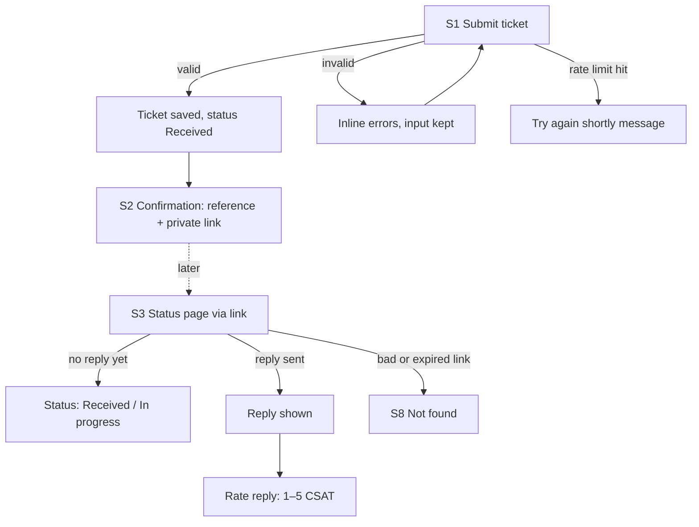
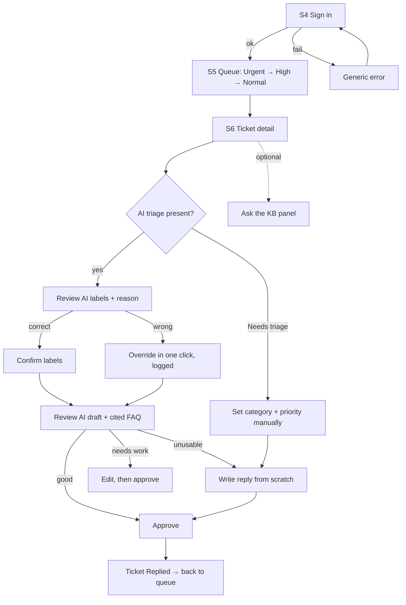
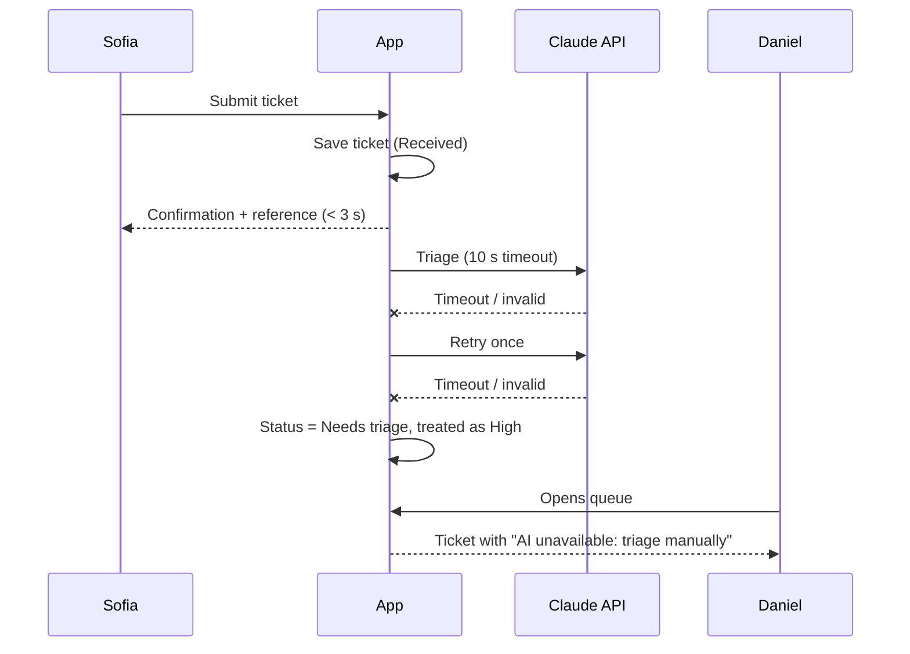
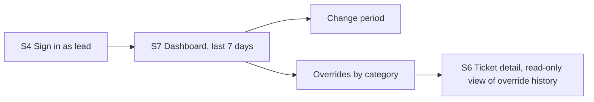

# UX specification — HelpDesk AI

| | |
| --- | --- |
| Version | 1.0 (draft for Gate 2) |
| Date | 2026-10-30 |
| Inputs | [BRD](../01-requirements/BRD.md) · [personas](../01-requirements/personas.md) · [user stories](../01-requirements/user-stories.md) · [NFRs](../01-requirements/nfrs.md) |
| Prototype | Built 2026-10-31: `/prototype` (code in `src/app/(prototype)/prototype`). URL map and review script in [prototype-feedback.md](prototype-feedback.md) |

Values marked **assumed** are UX proposals, to be checked in the prototype review or UAT.

---

## 1. Design principles (CX principles)

Each principle is a testable statement. Phases 4–6 test against these.

| # | Principle | Testable statement | Screens | How it's tested |
| --- | --- | --- | --- | --- |
| P1 | **Acknowledge fast** | The customer sees a reference number < 3 s after submitting, even if the AI is slow or down | S1, S2 | Playwright timing with a slow AI mock; NFR-02 |
| P2 | **The human approves** | No AI-generated text reaches a customer without an agent's explicit approval | S3, S6 | Automated send-path test (NFR-14); code review |
| P3 | **AI is visible and reversible** | Every AI output carries an "AI-suggested" label, a reason, and a one-click override | S5, S6 | Playwright: badge, "Why?" and override present on every AI field |
| P4 | **Usable by everyone** | Every task can be completed by keyboard and screen reader; 0 serious axe violations | All | axe-core in Playwright; manual keyboard pass (NFR-13) |
| P5 | **Calm, not alarming** | Customer-facing copy is plain, makes no promises, and never mentions AI internals | S1–S3, S8 | Content review against §5; UAT Customer Effort Score |

## 2. User flows

### 2.1 Customer: Sofia


### 2.2 Agent: Daniel and Amara


### 2.3 Fallback: AI unavailable (US-09)


### 2.4 Team lead: Priya


## 3. Screens

Conventions for every screen:
- Components are shadcn/ui names. "Loading", "Empty" and "Error" states are mandatory.
- Wireframes are low-fidelity layout sketches, not visual design.

### S1 · Submit ticket — US-01 · core
- **Purpose:** let Sofia report a problem in under 2 minutes, on a phone.
- **Route:** `/` (or `/support`).
- **Content:** "Larkfield Goods" wordmark (text, teal accent; fictional brand, UX-6), heading "Contact
  support", one-line intro, then the form:
  - **Name**, required.
  - **Email**, required, with the hint "We'll only use this to tell you about this request".
  - **Subject**, 5–120 characters.
  - **Description**, 20–5,000 characters, with a character counter announced politely.
  - A **Submit** button.
- **Components:** `Form`, `Input`, `Textarea`, `Button`, `Label`, field error text.
- **Primary action:** Submit.

```
┌───────────────────────────────┐
│ Contact support               │
│ Tell us what's wrong and we'll│
│ get back to you.              │
│                               │
│ Name        [_______________] │
│ Email       [_______________] │
│ Subject     [_______________] │
│ Description                   │
│ [                           ] │
│ [                           ] │
│                    120/5000   │
│ [        Submit request     ] │
└───────────────────────────────┘
```

| State | Behaviour |
| --- | --- |
| Loading (submitting) | Button shows a spinner and "Sending…"; disabled to prevent double submit; fields stay visible |
| Error (validation) | Errors next to each field and linked with `aria-describedby`; summary at top in a live region; focus moves to the first invalid field; input kept |
| Error (server/network) | "We couldn't send your request. Please try again." Input kept; retry button |
| Error (rate limit) | "You've sent several requests in a short time. Please try again in a few minutes." Input kept |
| Empty | n/a (the form is the empty state) |

### S2 · Confirmation — US-02 · part of the S1 flow
- **Purpose:** prove receipt instantly (P1) and give Sofia a way back.
- **Content:**
  - "Thanks, we've got your request" and the **reference `HD-24817`** in large type.
  - "Your private link" with a **Copy link** button and a short warning: "Anyone with this link can
    see your request".
  - **What happens next:** "An agent will review your request and reply here. You can check the
    status at any time using your link."
  - Nothing about AI and no time promise.
- **Components:** `Card`, `Button` (copy, with an "Copied" announcement), `Alert` (link warning).

```
┌───────────────────────────────┐
│ ✓ Thanks, we've got your      │
│   request                     │
│   Reference  HD-24817         │
│                               │
│ Your private link             │
│ [https://…/t/9fK2…] [Copy]    │
│ ⓘ Anyone with this link can   │
│   see your request.           │
│                               │
│ What happens next             │
│ An agent will review your     │
│ request and reply here.       │
└───────────────────────────────┘
```

| State | Behaviour |
| --- | --- |
| Loading | n/a: shown only after the save succeeds (target < 3 s total) |
| Error | If the save failed, S1's server error is shown instead; never a confirmation without a saved ticket |

### S3 · Ticket status (customer) — US-07, US-10 · core
- **Purpose:** Sofia checks progress and reads the reply without contacting anyone.
- **Route:** `/t/[token]` (unguessable token; the reference number alone never opens it).
- **Content:**
  - Reference, subject, submitted date.
  - A **status stepper**: Received → In progress → Replied. The current step is shown in text, not
    only by colour.
  - Her original description, collapsible.
  - **The reply**, once sent: agent first name, date, and the body.
  - **Rating**, after the reply (US-10): "How satisfied are you with this reply?" on a **1–5 CSAT
    scale** (radio group, 1 = Very dissatisfied … 5 = Very satisfied, every point labelled in text)
    and an optional comment (≤ 500 characters). Once rated: "Thanks for your feedback" plus the
    rating she gave.
- **Never shown:** AI labels, priority, sentiment, summary, unapproved drafts (US-07 AC2).
- **Components:** `Card`, a custom stepper (`ol` with `aria-current="step"`), `RadioGroup`, `Button`,
  `Textarea`, `Collapsible`.

```
┌───────────────────────────────┐
│ HD-24817 · Charged twice      │
│ Submitted 30 Oct, 10:42       │
│                               │
│ ● Received ─ ● In progress ─ ○ Replied │
│ Status: In progress           │
│                               │
│ ▸ Your message                │
│                               │
│ (when replied)                │
│ Reply from Daniel · 30 Oct    │
│ Hi Sofia, …                   │
│                               │
│ How satisfied are you with    │
│ this reply?                   │
│ (1) (2) (3) (4) (5)           │
│ Very dissatisfied … Very sat. │
│ Comment (optional) [_______]  │
└───────────────────────────────┘
```

| State | Behaviour |
| --- | --- |
| Loading | Skeleton for the card; no layout jump |
| Empty (no reply yet) | "No reply yet. We'll post it here as soon as an agent has replied." |
| Error (invalid/expired link) | S8 Not found |
| Error (rating failed) | "We couldn't save your rating. Please try again." Selection kept |
| Already rated | Scale replaced by the recorded rating; no second rating (US-10 AC2) |

### S4 · Agent sign-in — US-12 · supporting
- **Content:** "Agent sign-in", email and password fields, a **Sign in** button. Demo credentials are
  shown only in the demo environment, as a hint for reviewers.
- **States:**
  - Loading: button spinner.
  - Error: "Email or password is incorrect" (generic, US-12 AC3).
  - Rate-limited: "Too many attempts. Try again in a few minutes."
- After sign-in, agents land on S5 and leads on S7. The header shows the signed-in name and a
  **Sign out** link.

### S5 · Agent queue — US-05, US-09 · core
- **Purpose:** Daniel always knows what to work on next; urgent first.
- **Route:** `/agent/queue`.
- **Layout:** a header (name, sign out, *Dashboard* link for leads), filter tabs **Open (n)** ·
  **Needs triage (n)** · **Replied**, then a table.
- **Table columns:** Priority · Reference · Subject (+ summary line if long) · Category · Sentiment ·
  Age · Status.
- **Sort:** Urgent → High (including "Needs triage") → Normal, oldest first within each level. The sort
  is fixed for the MVP, so there are no sort controls to misuse.
- **Badges:**
  - Priority badge: text plus icon plus colour, e.g. `▲ Urgent`, never colour alone.
  - AI state, under the priority: **AI · unconfirmed** or **✓ Confirmed by Amara**.
  - Low confidence: **⚠ Low confidence**.
  - Needs triage: **AI unavailable**, with priority shown as **High (default)**.
- **Refresh (UX-3, hybrid):** the app checks every 30 s. New tickets show a polite notice "3 new
  tickets · Refresh". A new **Urgent** ticket shows a prominent amber notice "1 new urgent ticket ·
  Refresh" (text and icon, announced with `aria-live="assertive"`). The list never re-orders until
  the agent clicks Refresh.
- **Components:** `Table`, `Badge`, `Tabs`, `Button`, `Tooltip`.

```
┌─────────────────────────────────────────────────────────────────────────┐
│ HelpDesk · Queue                                Daniel Kim · Sign out   │
│ [Open (14)] [Needs triage (1)] [Replied]       3 new tickets [Refresh]  │
├──────────────┬─────────┬──────────────────────┬──────────┬──────┬──────┤
│ Priority     │ Ref     │ Subject              │ Category │ Tone │ Age  │
├──────────────┼─────────┼──────────────────────┼──────────┼──────┼──────┤
│ ▲ Urgent     │HD-24817 │ Charged twice        │ Payment  │ Upset│ 4m   │
│ AI·unconfirm │         │                      │          │      │      │
│ ■ High       │HD-24811 │ Parcel never arrived │ Delivery │ Calm │ 22m  │
│ AI unavailable│HD-24809│ (Needs triage)       │ —        │ —    │ 31m  │
│ ● Normal     │HD-24805 │ Sizes for jacket?    │ Product Q│ Calm │ 1h   │
│ ⚠ Low conf.  │         │ ↳ "Asks about sizing…"│         │      │      │
└──────────────┴─────────┴──────────────────────┴──────────┴──────┴──────┘
```

| State | Behaviour |
| --- | --- |
| Loading | Table skeleton with 5 rows |
| Empty | "No open tickets. Nice work." plus a link to the **Replied** tab |
| Error | "Couldn't load the queue." with a retry; the last loaded list stays visible if there is one |

### S6 · Ticket detail (agent) — US-03, US-04, US-06, US-11 · core
- **Purpose:** Daniel checks the AI's work, fixes it if needed, and sends a correct reply, without
  losing control.
- **Route:** `/agent/tickets/[ref]`.
- **Layout (desktop two-column):**
  - **Left, the ticket:** reference, subject, received time, customer first name (full name and email hidden by
    default; **Show contact** reveals them and logs who revealed them and when, UX-5), **summary block** for long tickets ("AI summary · check the
    full message"), and the **full message**, always visible.
  - **Right, the triage panel:**
    - **Category** select · **Priority** select · **Sentiment** (read-only), each with the AI value
      pre-selected and labelled **AI-suggested · High/Medium/Low confidence** (§4).
    - **Why?** disclosure with the one-line reason.
    - **Confirm labels** button: one click when the AI is right. Changing a select counts as an
      override; on save it's logged and the badge becomes "Confirmed by Daniel".
  - **Below, the reply:**
    - **Draft editor** pre-filled with the AI draft, labelled **AI-suggested draft**.
    - **Sources:** chips for the cited FAQ entries; clicking one opens the entry in a side sheet.
    - Buttons: **Approve and send** (primary), **Discard draft and write my own** (secondary).
  - **Ask the KB** (US-11, Could): collapsible side panel with a question input; the answer cites FAQ
    entries or says "Not in the knowledge base".
- **Banners:**
  - Low confidence: "**Low confidence:** the AI wasn't sure about this one. Read the full message
    before confirming."
  - Needs triage: "**AI unavailable:** set the category and priority yourself. No draft was
    generated."
  - Non-English: "**Non-English ticket:** no draft generated. Reply manually."
  - No FAQ match: "**No FAQ match:** write a personal reply." The editor starts empty.
- **Approve flow:** a confirmation step for the send ("Send this reply to the customer?") with the
  final text shown. After sending: **back to the queue** with a toast "Reply sent · HD-24817" (UX-4).
  Rationale (product owner): "agents need at least a split-second to recoup". It also shows any new
  urgent ticket before the agent picks the next one.
- **Components:** `Select`, `Badge`, `Collapsible`, `Textarea` (or a simple rich-text field), `Button`,
  `AlertDialog`, `Sheet`, `Alert`, `Toast`.

```
┌──────────────────────────────────────┬──────────────────────────────────┐
│ HD-24817 · Charged twice             │ Triage                           │
│ Received 10:42 · Sofia [Show contact]│ Category [Payment & billing ▾]   │
│                                      │   AI-suggested · High confidence │
│ ┌ AI summary · check the full msg ─┐ │ Priority [Urgent ▾]              │
│ │ Charged twice for order 5521.    │ │   AI-suggested · High confidence │
│ └──────────────────────────────────┘ │ Sentiment  Upset (AI)            │
│ Full message                         │ ▸ Why? "Two identical charges…"  │
│ I ordered on Monday and my bank …    │ [ Confirm labels ]               │
│ …                                    │                                  │
├──────────────────────────────────────┴──────────────────────────────────┤
│ Reply   AI-suggested draft                                  ▸ Ask the KB│
│ ┌─────────────────────────────────────────────────────────────────────┐ │
│ │ Hi Sofia, I'm sorry about the double charge…                        │ │
│ └─────────────────────────────────────────────────────────────────────┘ │
│ Sources: [FAQ 7 · Duplicate charges] [FAQ 3 · Refund timelines]         │
│ [ Discard draft and write my own ]               [ Approve and send ]   │
└─────────────────────────────────────────────────────────────────────────┘
```

| State | Behaviour |
| --- | --- |
| Loading | Skeletons for the ticket, triage and draft areas |
| Triage pending (AI still running) | Triage panel shows "AI is reviewing this ticket…" with the selects editable; the agent can start without waiting |
| Needs triage / non-English / no FAQ match | Banners above |
| Error (send failed) | "Reply not sent. Please try again." Text kept; ticket status unchanged |
| Error (approve empty) | "Write a reply before sending" (US-06 AC5) |
| Already replied | Read-only view: sent reply, who sent it, edit level, label history, contact reveals |

### S7 · Team-lead dashboard — US-08 · supporting
- **Route:** `/agent/dashboard` (lead role only; agents get 403 with a link back to the queue).
- **Controls:** period select (last 7 days by default, also 24 hours and 30 days).
- **Widgets:** each has a heading, the number, and a "View as table" toggle (WCAG text alternative).
  1. Tickets by **category** (bar).
  2. Tickets by **priority** and **status** (stacked bar or table).
  3. **Draft outcome:** approved unchanged / minor edit / major edit / unused (bar, %).
  4. **Override rate** by category (table), with links to the tickets.
  5. **Median time** to acknowledgement and to first reply (stat tiles).
  6. **Needs triage** count · **Product feedback** count · **CSAT**: average score and % rating 4–5
     (stat tiles).
- **Empty:** each widget shows "No tickets in this period", never zero-filled charts (US-08 AC4).
- **Error:** per-widget error with retry; other widgets still render.

### S8 · Not found / generic error — supporting
- "We can't find that page. If you're looking for a support request, use the link from your
  confirmation." Plus a link to S1.
- The same page is used for invalid, expired or tampered status links. It doesn't reveal whether a
  ticket exists (US-02 AC3).

## 4. AI trust cues

| Cue | Spec | Where | Story |
| --- | --- | --- | --- |
| **AI badge** | Text badge "AI-suggested", neutral colour, never alarming | Every AI value (S5, S6) | US-03, US-04 |
| **Confirmation state** | "AI · unconfirmed" → "✓ Confirmed by <name>" after confirm or override | S5, S6 | US-05, US-06 |
| **Confidence** | Shown as a **word**: High / Medium / Low confidence. The exact % is in a tooltip and in the "Why?" panel. Bands (agreed, UX-1): High ≥ 0.85, Medium 0.60–0.85, Low < 0.60; recalibrated after `/eval` | S5 (Low only), S6 (all) | US-03, US-05 |
| **"Why?"** | Collapsible with the one-line reason; for drafts, the cited FAQ entries | S6 | US-03, US-04 |
| **One-click override** | AI value pre-selected in an editable `Select`; changing it is an override; one **Confirm labels** button when the AI is right | S6 | US-06 |
| **Low-confidence banner** | Amber `Alert` with text and icon; asks for a full read | S5 (badge), S6 (banner) | US-05 AC3 |
| **AI unavailable** | Grey badge "AI unavailable"; priority shows "High (default)"; banner on S6 | S5, S6 | US-09 |
| **Summary block** | Shown when the description is **> 125 words** (UX-2); boxed, labelled "AI summary · check the full message"; full text always below | S5 (one line), S6 | US-03 AC2 |
| **Draft label and sources** | "AI-suggested draft" plus FAQ source chips; "No FAQ match" when empty | S6 | US-04 |
| **Edit level** | Recorded silently on approval (none / minor / major); shown only afterwards, in the read-only view and the dashboard, so it doesn't nudge agents to approve drafts unchanged (RAID R10) | S6 (read-only), S7 | US-06 |
| **Send confirmation** | `AlertDialog` showing the final text before sending | S6 | US-06 AC2 |
| **Customer side** | No AI cue at all, because no AI content is ever shown to the customer | S1–S3 | US-07 AC2 |

## 5. Content and microcopy

**Tone:** plain, calm, specific. No promises of time, refunds or outcomes. Use "we" for the retailer.
Customers never see the words "AI", "model" or "triage".

| Key | Text |
| --- | --- |
| Form error: required | "Please enter your {field}." |
| Form error: email | "Please enter an email address like name@example.com." |
| Form error: too short | "Please add a bit more detail (at least 20 characters)." |
| Confirmation: heading | "Thanks, we've got your request" |
| Confirmation: next steps | "An agent will review your request and reply here. You can check the status at any time using your link." |
| Link warning | "Anyone with this link can see your request. Don't share it." |
| Status names | Received · In progress · Replied |
| Status page: no reply yet | "No reply yet. We'll post it here as soon as an agent has replied." |
| Rating prompt | "How satisfied are you with this reply?" (1 Very dissatisfied · 2 Dissatisfied · 3 Neutral · 4 Satisfied · 5 Very satisfied) |
| Rating thanks | "Thanks for your feedback." |
| Agent: AI unavailable | "AI unavailable: set the category and priority yourself. No draft was generated." |
| Agent: low confidence | "Low confidence: the AI wasn't sure about this one. Read the full message before confirming." |
| Agent: no FAQ match | "No FAQ match: write a personal reply." |
| Agent: KB no answer | "Not in the knowledge base. Check with your team lead." |
| Agent: empty queue | "No open tickets. Nice work." |
| Agent: new tickets | "{n} new tickets · Refresh" / "{n} new urgent ticket(s) · Refresh" |
| Agent: reply sent | "Reply sent · {ref}" |
| Agent: send confirm | "Send this reply to the customer? They'll see it on their status page." |
| Not found | "We can't find that page. If you're looking for a support request, use the link from your confirmation." |

## 6. Accessibility (WCAG 2.2 AA)

- **Structure:** one `h1` per page; landmarks (`header`, `main`, `nav`); a skip link to main content.
- **Forms:**
  - Every input has a visible `label`.
  - Errors are linked with `aria-describedby`; an error summary sits in an `aria-live="assertive"`
    region; focus moves to the first error.
  - Required fields are marked in text, not only with `*`.
- **Focus:** a visible focus ring (≥ 3:1 contrast); a logical tab order (S6: ticket → triage → reply →
  actions); focus is trapped in dialogs and returned on close.
- **Colour:** priority, status and confidence are always shown in text or icon as well as colour; text
  contrast ≥ 4.5:1, UI components ≥ 3:1.
- **Targets:** at least 24×24 px (WCAG 2.2 SC 2.5.8); badges in table rows that can be clicked meet it.
- **Dynamic content:** the "new tickets" notice and toasts use `aria-live="polite"`; the queue never
  re-orders without the user asking (no unexpected focus loss).
- **Charts:** every chart has a "View as table" alternative and a text summary.
- **Status stepper:** an `ol` with `aria-current="step"`; the step is stated in text ("Status: In
  progress").
- **Motion:** respects `prefers-reduced-motion`; no auto-animating content.
- **Authentication (SC 3.3.8):** sign-in allows password managers and paste; no cognitive tests.

## 7. Responsive behaviour

| Screens | Target | Behaviour |
| --- | --- | --- |
| S1–S3, S8 (customer) | **Mobile-first**, 360 px and up | Single column; full-width buttons; the private link wraps and the copy button stays reachable |
| S4–S7 (agent/lead) | **Desktop**, ≥ 1024 px; works at tablet width (768 px) | S6 two-column → stacked below 1024 px (ticket, triage, reply); S5 table → hides the Sentiment and Age columns below 768 px; S7 widgets in a 2-column grid → 1 column |

## 8. Decisions (agreed with the product owner, 2026-10-30)

| # | Item | Decision | Status |
| --- | --- | --- | --- |
| UX-1 | Confidence word bands | High ≥ 0.85 · Medium 0.60–0.85 · Low < 0.60 | Agreed; recalibrate after `/eval` (models tend to be overconfident) |
| UX-2 | Long-ticket summary threshold | Shown when the description is **> 125 words** (PO's number) | Agreed; prototype shows tickets at ~110 and ~140 words |
| UX-3 | Queue refresh | **Hybrid:** check every 30 s; polite "n new tickets" notice; prominent, announced notice for new Urgent tickets; rows never move without the agent's click | Agreed |
| UX-4 | After sending a reply | **Back to the queue** with a toast. PO: "agents need at least a split-second to recoup" | Agreed; reviewers' expectation noted in prototype review |
| UX-5 | Customer contact details on S6 | Hidden behind **Show contact**; each reveal logged (who, when) | Agreed |
| UX-6 | Visual style | shadcn/ui defaults, light mode only; light brand on customer screens: fictional **"Larkfield Goods"**, teal accent `#0f766e` (5.47:1 on white, measured). Dark mode on roadmap | Agreed; brand name changeable |
| UX-7 | Rating scale | **1–5 CSAT** ("How satisfied are you with this reply?") + optional comment. Chosen by PO over the proposed Yes/No | Agreed; US-10 and US-08 updated |
