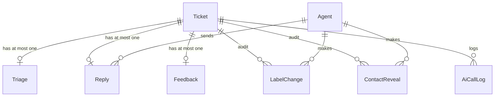
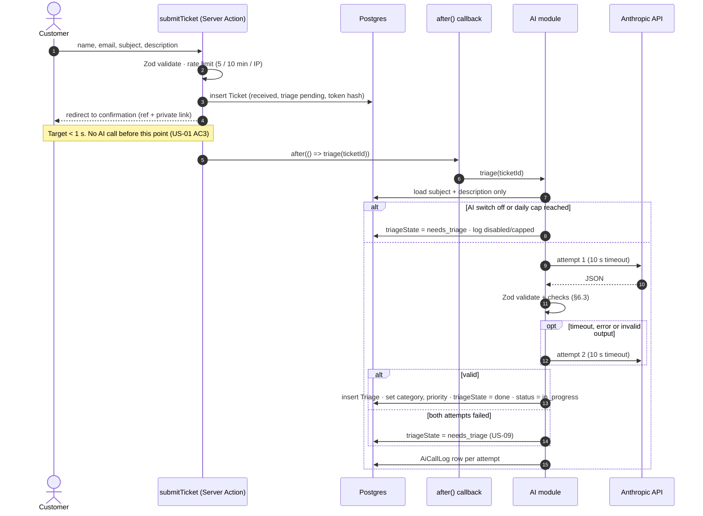

# Architecture — HelpDesk AI

| | |
| --- | --- |
| Version | 0.1 (draft for Gate 3) |
| Date | 2026-10-31 |
| Inputs | [BRD](../01-requirements/BRD.md) §6–8 · [user stories](../01-requirements/user-stories.md) · [NFRs](../01-requirements/nfrs.md) · [UX spec](../02-design/ux-spec.md) v1.1 |
| Decisions | [ADR 0001–0005](adr/) |

Figures marked **assumed** are estimates, not measurements. They're re-checked in Phase 5.

## 1. Quality goals

The design is driven by five promises. Everything else follows from them.

| # | Promise | How the design keeps it | NFRs |
| --- | --- | --- | --- |
| Q1 | The customer never waits on the AI | Save first, triage after the response (§4, ADR 0004) | NFR-01, 02 |
| Q2 | No AI text reaches a customer without an agent | Customers only ever see `Reply` rows; only an agent action creates one (§4.4) | NFR-14 |
| Q3 | Every AI output is checked, logged and reversible | Zod at the boundary, `AiCallLog`, `LabelChange` (§6) | NFR-04, 05, 08 |
| Q4 | Customer data stays minimal and out of the AI | Payload builder takes subject and description only; hashed link tokens; 90-day retention (§7) | NFR-06, 09, 15 |
| Q5 | It runs for ≤ $5/month | Haiku 5.5, rate limits, a daily AI cap and an off switch (§8) | NFR-12 |

## 2. Components

```mermaid
flowchart LR
  subgraph Browser
    C[Customer<br/>S1–S3, S8]
    A[Agent / lead<br/>S4–S7]
  end
  subgraph Vercel["Vercel (one Next.js 16 app)"]
    P[proxy.ts<br/>agent route guard]
    UI[Server Components<br/>pages]
    SA[Server Actions<br/>forms and mutations]
    RH[Route Handlers<br/>Auth.js, cron]
    AI[AI module<br/>src/ai]
    AF[after&#40;&#41;<br/>background triage]
  end
  DB[(Postgres on Neon<br/>via Prisma)]
  ANT[Anthropic API<br/>claude-haiku-5-5]
  OBS[Sentry +<br/>Vercel Analytics]
  REPO[[Repo files:<br/>FAQ, prompts]]

  C --> UI
  C --> SA
  A --> P --> UI
  A --> SA
  A --> RH
  SA --> DB
  UI --> DB
  SA --> AF --> AI
  SA --> AI
  AI --> ANT
  AI --> DB
  AI --> REPO
  RH --> DB
  UI -.errors.-> OBS
  SA -.errors.-> OBS
```

| Component | Responsibility | Lives in |
| --- | --- | --- |
| Pages | Customer pages S1–S3, S8; agent pages S4–S7 | `src/app/(customer)`, `src/app/(agent)` |
| Server Actions | Every write: submit, rate, sign in, check labels, send reply, reveal contact, ask the KB | `src/server/actions/*` |
| Route Handlers | Auth.js endpoints; daily retention cron | `src/app/api/auth/[...nextauth]`, `src/app/api/cron/retention` |
| `proxy.ts` | Redirects signed-out users away from `/agent/*` (first line of defence; every action checks again) | `src/proxy.ts` |
| AI module | Payload builder, prompt loader, Anthropic client, Zod schemas, call logging | `src/ai/*`, prompts in `src/ai/prompts/` |
| Data access | Prisma client and small query functions; no SQL in pages | `src/server/db/*` |
| Validation | Zod schemas shared by forms, actions and the AI module | `src/lib/schemas/*` |
| FAQ | Versioned JSON (`faq.v1.json`), entries with stable IDs `FAQ-1`… | `src/content/` |

The Phase 2 prototype (`src/app/(prototype)`) is deleted before release (RAID R14).

## 3. Data model

| Table | Key fields | Notes |
| --- | --- | --- |
| `Ticket` | `id`, `ref` (`HD-` + Postgres sequence from 24800), `status` (`received` · `in_progress` · `replied`), `triageState` (`pending` · `done` · `needs_triage`), `customerName`, `customerEmail`, `subject`, `description`, `statusTokenHash`, `category`, `priority` (current values, set by triage then by agents), `labelsCheckedBy`, `createdAt`, `triageStartedAt`, `firstReplyAt` | `ref` is human-readable and **not** a secret. The status link uses a separate token (§7.2). `createdAt` is the acknowledgement time: the customer sees the reference in the same response |
| `Triage` | `ticketId` (unique), `category`, `priority`, `sentiment`, `confCategory`, `confPriority`, `confSentiment`, `reason`, `summary?`, `draft?`, `sources[]`, `flags[]` (`low_confidence`, `non_english`, `no_faq_match`), `promptVersion`, `model`, `latencyMs` | Written once, from a validated AI response. Never updated: it's the record of what the AI said (BRD §7 must-never 5) |
| `Reply` | `ticketId` (unique), `body`, `sentById`, `sentAt`, `fromDraft` (bool), `editLevel` (`none` · `minor` · `major` · `rewritten`) | The **only** table whose text a customer ever sees (Q2) |
| `Agent` | `id`, `email` (unique), `name`, `role` (`agent` · `lead`), `passwordHash` | Seeded: one agent, one lead (US-12 AC5) |
| `Feedback` | `ticketId` (unique), `rating` 1–5, `comment?`, `createdAt` | Unique per ticket, so a second rating is rejected by the database too (US-10 AC2) |
| `LabelChange` | `ticketId`, `agentId`, `field`, `from`, `to`, `kind` (`checked` · `override` · `set_without_ai`), `at` | Every check or change (US-06 AC3, UX-8, UX-11) |
| `ContactReveal` | `ticketId`, `agentId`, `at` | UX-5 |
| `AiCallLog` | `ticketId?`, `purpose` (`triage` · `kb`), `promptVersion`, `model`, `attempt`, `latencyMs`, `inputTokens`, `outputTokens`, `cacheReadTokens`, `outcome` (`ok` · `timeout` · `api_error` · `invalid_output` · `refused` · `disabled` · `capped`), `at` | No ticket text, no customer data (NFR-08, Q4) |
| `RateLimit` | `key` (e.g. `submit:<ip-hash>`, `signin:<ip-hash>:<email-hash>`), `windowStart`, `count` | Fixed-window counter in Postgres; IPs and emails stored only as SHA-256 hashes |

**Status for the customer** (S3 stepper): `received` → `in_progress` (when triage finishes or an agent opens it) → `replied` (when a `Reply` exists).

## 4. Ticket lifecycle

### 4.1 Submit and triage

- `submitTicket` sets `export const maxDuration = 60` on its route segment, so `after()` has room for
  two 10 s attempts plus database writes. Worst case is about 25 s.
- **Lost-job sweep.** If the function is killed mid-triage, the ticket would stay `pending` for ever.
  So every queue load runs one `UPDATE … SET triageState = 'needs_triage' WHERE triageState = 'pending'
  AND createdAt < now() - interval '2 minutes'`. No cron is needed, and the queue never shows a ticket
  stuck in "AI is reviewing".
- **Agents never wait either.** A `pending` ticket shows "AI is reviewing this ticket… You can set the
  labels yourself" (S6, as in the prototype). Labels an agent sets win; a later triage result still
  saves its `Triage` row but doesn't overwrite agent-set values.

### 4.2 Agent checks labels (US-06, UX-8)
`checkLabels` action: re-check session → load ticket → for each field write a `LabelChange`
(`checked` if unchanged from the AI, `override` if changed, `set_without_ai` if there was no AI
value) → update `Ticket.category/priority`, `labelsCheckedBy`. Priority changes are only ever made
here, by an agent (BRD §7 must-never 5).

### 4.3 Agent sends a reply (US-06, UX-4, UX-11)
`sendReply` action: re-check session → Zod (`body` non-empty after trim, ≤ 5,000) → in one
transaction: insert `Reply` with `editLevel` (§6.5) → if labels aren't checked yet, write
`LabelChange` rows of kind `checked` for the current values (UX-11) → `status = replied`,
`firstReplyAt` → redirect to the queue with the toast.

### 4.4 What the customer can see (US-07, Q2)
The status page query selects `ref`, `subject`, `description`, `createdAt`, `status` and the `Reply`
— and nothing from `Triage`. The query lives in one function, `getCustomerView(tokenHash)`, with a
unit test asserting that its result type has no AI fields (US-07 AC2, NFR-14).

### 4.5 Ask the knowledge base (US-11, Could)
`askKb` action, agents only: question (≤ 500 chars) + FAQ → `{ answer, source | null }` → shown in
S6. Nothing about the ticket or customer is sent (US-11 AC4). Rate-limited per agent; logged in
`AiCallLog` with `purpose = kb`.

## 5. Server Actions and routes

| Name | Who | Input (Zod) | Effect |
| --- | --- | --- | --- |
| `submitTicket` | Anyone | name, email, subject 5–120, description 20–5,000 | Rate limit; insert `Ticket`; `after()` triage; redirect to confirmation |
| `rateReply` | Holder of a valid status token | token, rating 1–5, comment ≤ 500 | Insert `Feedback` (unique per ticket) |
| `signIn` / `signOut` | Anyone / agent | email, password | Auth.js Credentials; rate limit 5 / 15 min per IP + email |
| `checkLabels` | Agent | ticketId, category, priority | `LabelChange` rows; update ticket |
| `sendReply` | Agent | ticketId, body, fromDraft | §4.3 |
| `revealContact` | Agent | ticketId | Insert `ContactReveal`; return email |
| `askKb` | Agent | question | §4.5 |
| `GET /api/cron/retention` | Vercel Cron (secret header) | — | Delete tickets older than 90 days (cascades) |
| Pages `/agent/*` | Agent (lead for `/agent/dashboard`) | — | Server Components read via `src/server/db` |
| Page `/t/[token]` | Holder of the token | token | `getCustomerView`; generic not-found otherwise |

Every action starts with the same two lines: `const session = await requireAgent()` (or
`requireLead()`), then `schema.parse(input)`. `proxy.ts` is only the first check: actions and pages
check again, because a Server Action can be called directly.

## 6. AI integration

### 6.1 Call shape
- **Model:** `claude-haiku-5-5` (ADR 0003). One call per ticket returns labels, confidences, reason,
  summary (if over 100 words, UX-2), draft and FAQ sources.
- **Structured output:** `client.messages.parse()` with `output_config.format = zodOutputFormat(TriageSchema)`,
  so the API returns JSON that matches the schema, and the SDK parses it. Our own `TriageSchema.safeParse`
  still runs before anything is saved (NFR-05).
- **Effort and thinking:** `output_config.effort: "low"` and thinking disabled, for fast, cheap
  classification. Re-checked against the eval in Phase 5 (`/eval`); raise effort if urgent recall
  suffers.
- **Timeout and retry:** client created with `timeout: 10_000` (ms) and `maxRetries: 0`; our own loop
  makes exactly one more attempt on timeout, API error or invalid output (NFR-04, US-09). The SDK's
  own retries are off so the 10 s + 1 retry rule is exact.
- **Refusals:** a `refusal` stop reason is treated like invalid output (Haiku 5.5 has no server-side
  fallback). Logged as `refused`.

### 6.2 What goes in (NFR-06, NFR-07)
- `buildTriagePayload({ subject, description })` is the only way to build the user message. Its type
  takes just those two strings, so name and email can't be passed by mistake; a unit test checks the
  serialized payload for a seeded name and email.
- The ticket is wrapped in `<ticket_subject>` / `<ticket_description>` tags, and the system prompt says
  text inside them is customer content to classify, never instructions (US-03 AC4).
- System prompt (`triage.v1.md`) + FAQ come first and are marked for prompt caching; the ticket comes
  last. Prompt files are never edited once released: a change means `triage.v2.md` (charter).

### 6.3 Checks after the schema passes
Treated as invalid output (retry, then "Needs triage") if:
- a cited source isn't an ID in the FAQ file;
- a draft is present with no sources and no `no_faq_match` flag;
- a summary is present but the description is ≤ 100 words, or missing when it's over 100 words.

Set by code, not by the model:
- `low_confidence` when category or priority confidence is < 0.60 (UX-1). Model confidences tend to be
  overconfident; the bands are recalibrated after `/eval`.
- `non_english` is the model's call, but then the draft is dropped (BRD A4, US-03 AC6).

### 6.4 Things code can't guarantee
The prompt tells the model never to promise refunds, compensation or dates the FAQ doesn't state
(US-04 AC3). Code can't check that reliably, so it's covered by: the agent approves every reply (Q2),
the eval set has cases for it (`/eval`), and the counter-metric in the BRD (≥ 90% of sampled approved
replies correct).

### 6.5 Edit level (US-08 AC2) — thresholds set here (assumed)
Compare the sent `body` with the AI `draft`, after trimming and collapsing whitespace:
- `none`: identical.
- `minor`: character edit distance ≤ 20% of the draft's length.
- `major`: more than 20%.
- `rewritten`: the agent discarded the draft (`fromDraft = false`).

The 20% line is assumed and is checked against real edits in UAT.

### 6.6 Switches and caps
- `AI_TRIAGE_ENABLED=false` sends new tickets straight to "Needs triage" (US-09 AC3).
- `AI_DAILY_CALL_CAP` (default 300): once reached, new tickets go to "Needs triage" with outcome
  `capped`. This protects the budget from a slow drip that the per-IP limit can't see (§8).

## 7. Security and privacy

### 7.1 Agents (NFR-10, ADR 0005)
- Auth.js v5 with the Credentials provider; seeded agent and lead; passwords hashed with argon2id.
- JWT session cookie (HTTP-only, Secure, SameSite=Lax), 8-hour lifetime, carrying `agentId` and `role`.
- Sign-in errors are generic (US-12 AC3); attempts rate-limited.
- Server Actions get Next.js's built-in Origin check against CSRF; no custom CORS.

### 7.2 Customer status links (NFR-09)
- Token: 16 random bytes from `crypto.randomBytes` (128 bits), base64url, 22 characters.
- Only `SHA-256(token)` is stored. A database leak doesn't hand out working links.
- Any unknown, malformed or deleted token gets the same generic not-found page (S8, US-02 AC3).
  The reference number alone never opens anything.
- `Referrer-Policy: no-referrer`, so the token can't leak to other sites through links on the page.

### 7.3 Headers
Set in `next.config.ts` for every route: `Strict-Transport-Security`, `X-Content-Type-Options: nosniff`,
`Referrer-Policy: no-referrer`, `Permissions-Policy` (camera, mic, geolocation off),
`Content-Security-Policy` with `frame-ancestors 'none'` and `default-src 'self'` (script and style
sources tightened in Phase 4 once Sentry and Analytics are wired in).

### 7.4 Personal data (NFR-15)
- Stored: customer name and email (to reply and to show on reveal), ticket text. Nothing else.
- Never sent to the AI (§6.2), never written to `AiCallLog`, never in console logs.
- Sentry: `sendDefaultPii: false`, request bodies dropped in `beforeSend`.
- Retention: a daily Vercel cron deletes tickets older than 90 days and everything linked to them;
  `AiCallLog` rows keep only counts and timings, with `ticketId` set to null.
- Fictional data only in the public demo; the demo shows a notice saying so.

### 7.5 Secrets
`ANTHROPIC_API_KEY`, `DATABASE_URL`, `AUTH_SECRET`, `SENTRY_DSN`, `CRON_SECRET` in Vercel env vars and
`.env.local`; `.env.example` lists every name with no values. The Anthropic key has a Console spend
limit (RAID I1/D1).

## 8. Cost estimate (per 1,000 tickets)

Pricing for `claude-haiku-5-5` (Anthropic list price, prompts ≤ 100K tokens): **$0.10 per million
input tokens, $0.50 per million output tokens**; cache reads 0.1× input. Haiku 5.5's tokenizer
counts about 30% more tokens than older models for the same text, which is included below.

| Item (per triage call) | Tokens (assumed) | Basis |
| --- | --- | --- |
| System prompt | ~1,000 | Rules, categories, priority table, output instructions |
| FAQ | ~1,500 | ~10 entries of ~80 words |
| Ticket | ~300 | ~150 words, wrapped in tags |
| **Input total** | **~2,800** | |
| Output (labels, reason, summary, ~180-word draft) | ~500 | JSON |

| Scenario | Per ticket | **Per 1,000 tickets** |
| --- | --- | --- |
| No cache hits | 2,800 × $0.10/M + 500 × $0.50/M = $0.00053 | **≈ $0.53** |
| Every call retried once (worst case) | 2 × $0.00053 | **≈ $1.06** |
| Cache hits on prompt + FAQ (busy periods only) | ~$0.00031 | ≈ $0.31 |
| Ask the KB (per question) | ~2,700 in, ~200 out ≈ $0.00037 | ≈ $0.37 per 1,000 questions |

**Against the $5/month cap (NFR-12):** about 9,000 tickets a month without retries, or 4,700 if every
call were retried. The demo will see far fewer. The danger is abuse: the per-IP limit (5 per 10 min)
still lets one address send 720 tickets a day, which is ~$0.38/day, or ~$11/month. Hence the
`AI_DAILY_CALL_CAP` of 300 (≤ ~$0.16/day, ~$5/month at the very worst) and the Console spend limit
as the final stop. Caching only helps when tickets arrive within 5 minutes of each other, so the
estimate doesn't rely on it.

Hosting: Vercel Hobby and Neon's free tier, $0 (assumed to stay within free limits at demo volume).

## 9. Traceability

| Story / NFR | Where |
| --- | --- |
| US-01 Submit | §4.1, §5 `submitTicket` |
| US-02 Confirmation + link | §4.1, §7.2 |
| US-03 Triage (+ summary) | §4.1, §6.1–6.3 |
| US-04 Draft | §6.1, §6.3, §6.4 |
| US-05 Queue | §3 (`triageState`, priority), §4.1 sweep |
| US-06 Check labels, send | §4.2, §4.3, §6.5 |
| US-07 Customer status | §4.4 |
| US-08 Dashboard | §3 (`createdAt`, `firstReplyAt`, `editLevel`, `Feedback`), lead-only pages §5 |
| US-09 Fallback | §4.1, §6.1, §6.6 |
| US-10 Rating | §3 `Feedback`, §5 `rateReply` |
| US-11 Ask the KB | §4.5 |
| US-12 Sign-in | §7.1, ADR 0005 |
| NFR-01/02 | §4.1 |
| NFR-03 | §6.1 (Haiku, low effort); measured by `AiCallLog.latencyMs` |
| NFR-04/05 | §6.1, §6.3 |
| NFR-06/07 | §6.2 |
| NFR-08 | §3 `AiCallLog`, §6.2 prompt files |
| NFR-09 | §7.2 |
| NFR-10 | §5, §7.1 |
| NFR-11 | §6.3 `non_english` |
| NFR-12 | §5 rate limits, §6.6, §8 |
| NFR-13 | Unchanged from the UX spec §6; axe in Playwright (§10) |
| NFR-14 | §4.4 |
| NFR-15 | §7.4 |
| NFR-16 | §6.1 effort re-check, `/eval` |
| NFR-17 | Playwright projects (§10) |

## 10. Test seams for Phase 4/5

| Seam | Test |
| --- | --- |
| `AiClient` interface | Vitest with a fake that can be slow, fail, return invalid JSON or refuse: proves the 10 s / 1 retry / "Needs triage" paths (NFR-04) |
| `buildTriagePayload` | Unit test: no name or email in the payload (NFR-06) |
| `TriageSchema` + §6.3 checks | Unit tests with good and bad fixtures (NFR-05) |
| `getCustomerView` | Unit test: no `Triage` fields in the result (NFR-14) |
| Server Actions | Integration tests against a Neon branch: signed-out calls rejected, agent vs lead (NFR-10) |
| Rate limits, switch, cap | Integration tests (NFR-12) |
| Each story | At least one Playwright test, with axe (charter, NFR-13) |
| Triage quality | `/eval`: accuracy, urgent recall, injection cases, non-English (NFR-07, 11, 16) |

## 11. Open questions for Gate 3
1. **Urgent safety net.** NFR-16 says 0 urgent tickets missed. Should code also flag tickets that
   mention charges, safety or account access when the AI says "Normal" (a flag for the agent, not a
   priority change)? It would catch misses the model makes, at the cost of some false alarms. Not
   in the MVP stories, so it needs your call.
2. **Edit-level threshold** of 20% (§6.5) is assumed; fine to start with?
