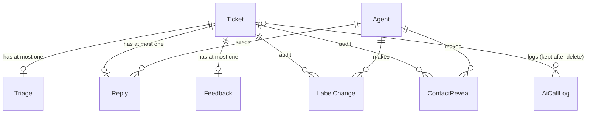
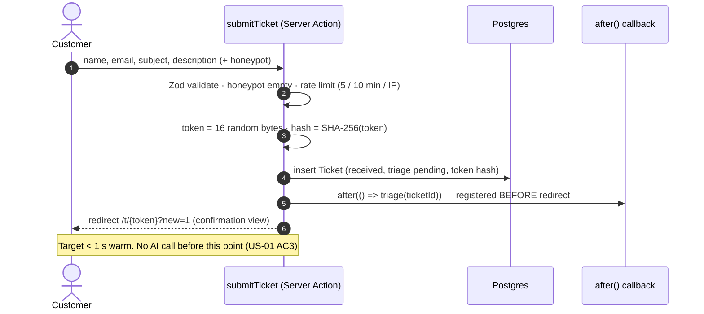
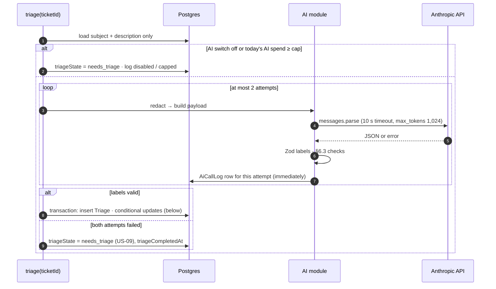

# Architecture — HelpDesk AI

| | |
| --- | --- |
| Version | 0.2 (architecture-reviewer findings applied, for Gate 3) |
| Date | 2026-10-31 |
| Inputs | [BRD](../01-requirements/BRD.md) §6–8 · [user stories](../01-requirements/user-stories.md) · [NFRs](../01-requirements/nfrs.md) · [UX spec](../02-design/ux-spec.md) v1.1 |
| Decisions | [ADR 0001–0005](adr/) · review findings in [architecture-review.md](architecture-review.md) |

Figures marked **assumed** are estimates, not measurements. They're re-checked in Phase 5.

## 1. Quality goals

The design is driven by five promises. Everything else follows from them.

| # | Promise | How the design keeps it | NFRs |
| --- | --- | --- | --- |
| Q1 | The customer never waits on the AI | Save first, triage after the response (§4, ADR 0004) | NFR-01, 02 |
| Q2 | No AI text reaches a customer without an agent | Customers only ever see `Reply` rows; only an agent action creates one (§4.5) | NFR-14 |
| Q3 | Every AI output is checked, logged and reversible | Zod at the boundary, an `AiCallLog` row per attempt, `LabelChange` (§6) | NFR-04, 05, 08 |
| Q4 | Customer data stays minimal and out of the AI and the logs | Redacted payload, hashed tokens, scrubbed telemetry, 90-day retention (§6.2, §7) | NFR-06, 09, 15 |
| Q5 | It runs for ≤ $5/month | Haiku 5.5, rate limits, a daily **dollar** cap and an off switch (§6.6, §8) | NFR-12 |

## 2. Components

```mermaid
flowchart LR
  subgraph Browser
    C[Customer<br/>S1–S3, S8]
    A[Agent / lead<br/>S4–S7]
  end
  subgraph Vercel["Vercel (one Next.js 16 app)"]
    P[proxy.ts<br/>agent route guard]
    UI[Server Components<br/>pages]
    SA[Server Actions<br/>forms and mutations]
    RH[Route Handlers<br/>Auth.js, queue status, cron]
    AI[AI module<br/>src/ai]
    AF[after&#40;&#41;<br/>background triage]
  end
  DB[(Postgres on Neon<br/>via Prisma)]
  ANT[Anthropic API<br/>claude-haiku-5-5]
  OBS[Sentry +<br/>Vercel Analytics<br/>scrubbed]
  REPO[[Repo files:<br/>FAQ, prompts]]

  C --> UI
  C --> SA
  A --> P --> UI
  A --> SA
  A --> RH
  SA --> DB
  UI --> DB
  SA --> AF --> AI
  SA --> AI
  AI --> ANT
  AI --> DB
  AI --> REPO
  RH --> DB
  UI -.errors.-> OBS
  SA -.errors.-> OBS
```



| Component | Responsibility | Lives in |
| --- | --- | --- |
| Pages | Customer pages S1–S3, S8; agent pages S4–S7. Reads only: no writes during render | `src/app/(customer)`, `src/app/(agent)` |
| Server Actions | Every write: submit, rate, sign in, open ticket, check labels, send reply, reveal contact, ask the KB | `src/server/actions/*` |
| Route Handlers | Auth.js; `GET /api/agent/queue-status` (30 s poll + lost-job sweep); daily retention cron | `src/app/api/*` |
| `proxy.ts` | Redirects signed-out users away from `/agent/*` (first check only; every action and handler checks again) | `src/proxy.ts` |
| AI module | Redaction, payload builder, prompt loader, Anthropic client, Zod schemas, per-attempt logging | `src/ai/*`, prompts in `src/ai/prompts/` |
| Data access | Prisma client and small query functions; no SQL in pages | `src/server/db/*` |
| Validation | Zod schemas shared by forms, actions and the AI module | `src/lib/schemas/*` |
| Telemetry | Sentry and Analytics setup with scrubbing (§7.4) | `src/lib/telemetry/*` |
| FAQ | Versioned JSON (`faq.v1.json`), entries with stable IDs `FAQ-1`… | `src/content/` |

The Phase 2 prototype (`src/app/(prototype)`) is deleted before release (RAID R14).

## 3. Data model



| Table | Key fields | Notes |
| --- | --- | --- |
| `Ticket` | `id`, `ref` (`HD-` + Postgres sequence from 24800), `status` (`received` · `in_progress` · `replied`), `triageState` (`pending` · `done` · `needs_triage`), `customerName`, `customerEmail`, `subject`, `description`, `statusTokenHash`, `category?`, `priority?` (current values), `labelsCheckedById?`, `createdAt`, `triageCompletedAt?`, `firstReplyAt?` | `ref` is human-readable and **not** a secret; only the token opens the status page (§7.2) |
| `Triage` | `ticketId` (unique), `category`, `priority`, `sentiment`, `confCategory`, `confPriority`, `confSentiment`, `reason`, `summary?`, `draft?`, `sources[]`, `flags[]` (`low_confidence`, `non_english`, `no_faq_match`, `summary_dropped`, `draft_dropped`, `url_in_draft`), `promptVersion`, `faqVersion`, `model` | Written once from a validated AI response, never updated: the record of what the AI said (BRD §7 must-never 5) |
| `Reply` | `ticketId` (unique), `body`, `sentById`, `sentAt`, `editLevel` (`none` · `minor` · `major` · `unused` · `no_draft`) | The **only** table whose text a customer ever sees (Q2). Rendered as plain text |
| `Agent` | `id`, `email` (unique), `name`, `role` (`agent` · `lead`), `passwordHash`, `active` | Seeded: one agent, one lead (US-12 AC5) |
| `Feedback` | `ticketId` (unique), `rating` 1–5, `comment?`, `createdAt` | Unique per ticket, so a second rating fails in the database too (US-10 AC2) |
| `LabelChange` | `ticketId`, `agentId`, `field`, `from?`, `to`, `kind` (`checked` · `override` · `set_without_ai`), `at` | Every check or change (US-06 AC3, UX-8, UX-11) |
| `ContactReveal` | `ticketId`, `agentId`, `at` | UX-5 |
| `AiCallLog` | `ticketId?`, `purpose` (`triage` · `kb`), `promptVersion`, `faqVersion`, `model`, `attempt`, `latencyMs`, `inputTokens`, `outputTokens`, `costUsd`, `outcome` (`ok` · `timeout` · `api_error` · `invalid_output` · `refused` · `disabled` · `capped` · `lost`), `at` | One row **per attempt, written as soon as it ends**. No ticket text or customer data (NFR-08, Q4) |
| `RateLimit` | `key` (e.g. `submit:<hmac(ip)>`), `windowStart`, `count` | Keys are HMAC-SHA-256 with a server secret, not plain hashes (an IPv4 hash is easy to reverse). Incremented atomically with `INSERT … ON CONFLICT DO UPDATE … RETURNING count`. Purged by the daily cron |

**Deletes** (Prisma `onDelete`): `Triage`, `Reply`, `Feedback`, `LabelChange`, `ContactReveal` cascade
with their `Ticket`; `AiCallLog.ticketId` is set to null, so cost and latency history survives.

**Customer-facing status** (S3 stepper):
- `received`: saved; nothing visible has happened yet. Stays `received` while the AI runs.
- `in_progress`: set only by an agent action: opening the ticket (`openTicket`) or checking labels.
  So the customer sees a person working on it, whether or not the AI ran.
- `replied`: a `Reply` exists.

## 4. Ticket lifecycle

### 4.1 Submit



- **Order matters:** `redirect()` throws in Next.js, so `after()` is called before it. An integration
  test checks that a submitted ticket gets a `Triage` row (or a logged failure), not just a sweep.
- **Confirmation (S2) is the status page with `?new=1`**: the URL the customer lands on *is* their
  private link, so the plaintext token never needs storing and the reference alone never opens
  anything (US-02 AC3). The page shows "Thanks, we've got your request", the reference, the link and
  its copy button, as in the UX spec.
- `export const maxDuration = 60` on the submit route, so `after()` has room for two 10 s attempts.

### 4.2 Triage (in `after()`)



**Conditional updates, in one transaction**, so a late AI result never overwrites an agent:
```sql
UPDATE ticket SET category = :c, priority = :p
  WHERE id = :id AND labels_checked_by_id IS NULL AND category IS NULL;
UPDATE ticket SET triage_state = 'done', triage_completed_at = now()
  WHERE id = :id AND triage_state = 'pending';
```
Status is not touched by triage (§3).

### 4.3 Queue refresh and the lost-job sweep (UX-3, US-05, US-09)
- The queue page calls `GET /api/agent/queue-status` every 30 s. It returns the count of new tickets
  and whether any is Urgent, and the page shows the polite or prominent notice. Rows only change when
  the agent clicks Refresh (`router.refresh()`), as agreed in UX-3.
- The same handler first runs the sweep, an idempotent single statement:
  `UPDATE … SET triage_state = 'needs_triage' WHERE triage_state = 'pending' AND created_at < now() - interval '2 minutes' RETURNING id`,
  and writes an `AiCallLog` row with outcome `lost` for each id. Pages never write during render.
- **Sort order** (US-05 AC1, US-09 AC4):
  1. Urgent, and any ticket flagged `review_now` (§6.3: a refusal)
  2. High, including `needs_triage` and `pending` tickets with no priority yet
  3. Normal

  Oldest first within each band.

### 4.4 Agent works the ticket (US-06, UX-8, UX-11)
- `openTicket(ticketId)`: called once when an agent opens S6; sets `status = in_progress` if it was
  `received`. Idempotent.
- `checkLabels(ticketId, category, priority, aiLabelsShown)`: for each field write a `LabelChange`:
  `checked` if equal to the AI's value, `override` if different, `set_without_ai` if there was no AI
  value **or the form was rendered before triage finished** (`aiLabelsShown = false`). This keeps the
  override rate honest (US-08 AC2). Then update the ticket and `labelsCheckedById`.

### 4.5 Send a reply
`sendReply(ticketId, body, usedDraft)`:
1. Re-check session; Zod (`body` non-empty after trim, ≤ 5,000).
2. Category and priority must be set (by the AI or the agent); otherwise "Set the category and
   priority first."
3. One transaction: insert `Reply` with `editLevel` (§6.5); if labels aren't checked yet, write
   `checked` `LabelChange` rows for the current values (UX-11); `status = replied`, `firstReplyAt`.
4. A unique-constraint error (double click, two agents) shows "This ticket already has a reply" and
   reloads the ticket.
5. Redirect to the queue with the toast (UX-4).

### 4.6 What the customer can see (US-07, Q2)
`getCustomerView(tokenHash)` selects `ref`, `subject`, `description`, `createdAt`, `status`, the
`Reply` and the `Feedback`, and nothing from `Triage`. A unit test asserts the result type has no AI
fields (US-07 AC2, NFR-14). `rateReply` only works when a `Reply` exists.

### 4.7 Ask the knowledge base (US-11, Could)
`askKb(question)`, agents only: question (≤ 500 chars, redacted like tickets) + FAQ, prompt
`kb.v1.md` → `{ answer, source | null }`. Nothing about the ticket or customer is sent (US-11 AC4).
Limit: 20 questions per agent per hour. Counts toward the daily AI cap and logs with `purpose = kb`.

## 5. Server Actions and routes

| Name | Who | Input (Zod) | Effect |
| --- | --- | --- | --- |
| `submitTicket` | Anyone | name, email, subject 5–120, description 20–5,000, honeypot | §4.1 |
| `rateReply` | Holder of a valid status token, once a Reply exists | token, rating 1–5, comment ≤ 500 | Insert `Feedback` |
| `signIn` / `signOut` | Anyone / agent | email, password | Auth.js Credentials; 5 tries / 15 min per IP + email |
| `openTicket` | Agent | ticketId | §4.4 |
| `checkLabels` | Agent | ticketId, category, priority, aiLabelsShown | §4.4 |
| `sendReply` | Agent | ticketId, body, usedDraft | §4.5 |
| `revealContact` | Agent | ticketId | Insert `ContactReveal`; return email |
| `askKb` | Agent | question | §4.7 |
| `GET /api/agent/queue-status` | Agent | `since` timestamp | §4.3 |
| `GET /api/cron/retention` | Vercel Cron (`CRON_SECRET`) | — | §7.4 |
| Pages `/agent/*` | Agent (lead for `/agent/dashboard`) | — | Read via `src/server/db` |
| Page `/t/[token]` | Holder of the token | token (base64url, 22 chars) | `getCustomerView`; generic not-found otherwise |

Every action and handler starts with `requireAgent()` / `requireLead()` (which also checks the agent
is still `active` in the database), then `schema.parse(input)`. `proxy.ts` is only the first check,
because a Server Action can be called directly.

**Choices considered:** rate limits in Postgres rather than Vercel WAF or Upstash (no extra service,
fine at demo volume); polling every 30 s rather than websockets or SSE (UX-3 asked for a 30 s check,
and polling is the simplest thing on serverless).

## 6. AI integration

### 6.1 Call shape
- **Model:** `claude-haiku-5-5` (ADR 0003). One call per ticket returns labels, confidences, reason,
  summary when asked for, draft and FAQ sources.
- **Structured output:** `client.messages.parse()` with `output_config.format = zodOutputFormat(TriageSchema)`,
  so the API returns JSON matching the schema. Our own `TriageSchema.safeParse` still runs before
  anything is saved (NFR-05). Chosen over tool use because there's exactly one output shape and no
  tools to call.
- **Effort and thinking:** `output_config.effort: "low"`, thinking disabled, `max_tokens: 1024`.
  Re-checked against the eval in Phase 5; raise effort if urgent recall suffers.
- **Timeout and retry:** client created with `timeout: 10_000` (ms) and `maxRetries: 0`; our loop makes
  exactly one more attempt on timeout, API error or invalid labels (NFR-04, US-09).
- **Refusal:** a `refusal` stop reason counts as a failed attempt. If both attempts refuse, the ticket
  goes to "Needs triage" with the `review_now` flag, sorted with Urgent (§4.3): safety and self-harm
  tickets are the likeliest to trip a classifier and the likeliest to be urgent.
- **No prompt caching in the MVP.** At demo volume nearly every call would be a cache write (1.25×
  input price), so caching would cost more, not less. Revisit if volume grows.

### 6.2 What goes in (NFR-06, NFR-07)
- **Redaction first.** `redact(text, { name, email })` replaces the submitted name (full name and each
  part of 3+ letters, case-insensitive, whole words) with `[name]`, the submitted email and anything
  matching an email pattern with `[email]`, and phone-number-like runs of 8+ digits with `[phone]`.
  Customers often sign their tickets, so the payload type alone isn't enough. Unit tests include a
  signed ticket and a quoted email address.
- `buildTriagePayload({ subject, description, summaryRequired })` is the only way to build the user
  message; its type takes no name or email. `summaryRequired` is computed by code (word count > 100,
  UX-2), because models can't count words reliably.
- The ticket is wrapped in `<ticket_subject>` / `<ticket_description>` tags, and the system prompt
  says text inside them is customer content to classify, never instructions (US-03 AC4).
- Prompt files `triage.v1.md` and `kb.v1.md`; the FAQ file `faq.v1.json`. Released files are never
  edited: a CI check compares their SHA-256 hashes with a committed list (Phase 4).
- **Keys:** the production key is used only by the deployed app. `/eval` and local development use a
  separate key (or workspace) with its own spend limit, so tests can't eat the demo budget.

### 6.3 Checks after the call
| Problem | Effect |
| --- | --- |
| Labels missing or fail Zod | Attempt failed (retry, then "Needs triage") |
| Summary returned when not asked for, missing when asked, or over 25 words | Summary dropped, flag `summary_dropped`; labels kept |
| A cited source isn't an FAQ ID, or a draft has no sources and no `no_faq_match` flag | Draft dropped, flag `draft_dropped`; labels kept |
| Draft contains a URL that isn't in the FAQ | Draft kept, flag `url_in_draft`, warning shown to the agent |
| Category or priority confidence < 0.60 | Flag `low_confidence` (UX-1; bands recalibrated after `/eval`) |
| `non_english` | Draft dropped (BRD A4, US-03 AC6) |

### 6.4 Things code can't guarantee
The prompt tells the model never to promise refunds, compensation or dates the FAQ doesn't state
(US-04 AC3). Code can't check that reliably. It's covered by the agent approving every reply (Q2),
eval cases for it, and the BRD counter-metric (≥ 90% of sampled approved replies correct).

### 6.5 Edit level (US-06 AC4, US-08 AC2) — thresholds set here (assumed)
Compare the sent `body` with the AI `draft`, after trimming and collapsing whitespace:
- `none`: identical.
- `minor`: character edit distance ≤ 20% of the draft's length.
- `major`: more than 20%.
- `unused`: the agent discarded the draft and wrote their own.
- `no_draft`: there was no draft (Needs triage, non-English, no FAQ match, draft dropped). Left out of
  the "approved unchanged or lightly edited" share (G3).

The 20% line is assumed and checked against real edits in UAT.

### 6.6 Switches and caps
- `AI_TRIAGE_ENABLED=false` sends new tickets straight to "Needs triage" (US-09 AC3).
- **Daily dollar cap**, `AI_DAILY_BUDGET_USD` (default 0.15): before each call, sum today's
  `AiCallLog.costUsd` (triage and KB). At or over the cap, new tickets go to "Needs triage" with outcome
  `capped`, and Ask the KB says it's unavailable today. $0.15/day ≈ $4.50/month, under the $5 limit
  whatever the ticket length.
- The Anthropic Console spend limit on the production key is the final stop.

## 7. Security and privacy

### 7.1 Agents (NFR-10, ADR 0005)
- Auth.js v5, Credentials provider; seeded agent and lead; passwords hashed with argon2id.
- JWT session cookie (HTTP-only, Secure, SameSite=Lax), 8-hour lifetime, carrying `agentId` and `role`.
  `requireAgent()` also looks the agent up, so deactivating one takes effect on their next request.
- Generic sign-in errors (US-12 AC3); attempts rate-limited.
- Server Actions use Next.js's built-in Origin check against CSRF.
- **Accepted for the demo:** the demo passwords are public, so anyone can read every (fictional)
  ticket and use Ask the KB within its limit (RAID).

### 7.2 Customer status links (NFR-09)
- Token: 16 random bytes from `crypto.randomBytes` (128 bits), base64url, 22 characters. Only its
  SHA-256 is stored.
- Any unknown, malformed or deleted token gets the same generic not-found page (S8, US-02 AC3).
- `Referrer-Policy: no-referrer` on every page.
- **The token must not reach telemetry** (§7.4).

### 7.3 Headers
Set in `next.config.ts`: `Strict-Transport-Security`, `X-Content-Type-Options: nosniff`,
`Referrer-Policy: no-referrer`, `Permissions-Policy` (camera, microphone, geolocation off),
`Content-Security-Policy` with `frame-ancestors 'none'` and `default-src 'self'` (script and connect
sources added for Sentry and Analytics in Phase 4).

### 7.4 Personal data and telemetry (NFR-15)
- Stored: customer name and email (to reply and to show on reveal) and ticket text. Nothing else.
- Never sent to the AI (§6.2), never in `AiCallLog`, never in console logs.
- **Sentry:** `sendDefaultPii: false`. `beforeSend` and `beforeSendTransaction` replace any `/t/<token>`
  path with `/t/[token]` in URLs, transaction names and breadcrumbs; drop request bodies; and replace
  exception messages from Prisma (which can include argument values such as an email) with the error
  code only. Unit-tested with a fake event.
- **Vercel Analytics:** its `beforeSend` rewrites `/t/<token>` to `/t/[token]`.
- Vercel's own request logs still contain paths; they're short-lived and visible only to the project
  owner (accepted, RAID).
- **Retention:** the daily cron deletes tickets older than 90 days (cascading as in §3, including open
  tickets nobody answered: accepted for a demo) and `RateLimit` rows older than a day.
- Fictional data only in the public demo; the demo says so.
- Drafts and replies are rendered as plain text, never HTML.

### 7.5 Secrets
`ANTHROPIC_API_KEY`, `DATABASE_URL`, `DIRECT_URL`, `AUTH_SECRET`, `RATE_LIMIT_SECRET`, `CRON_SECRET`,
`SENTRY_DSN`, `AI_TRIAGE_ENABLED`, `AI_DAILY_BUDGET_USD` in Vercel env vars and `.env.local`;
`.env.example` lists every name with no values (updated in Phase 4).

## 8. Cost estimate (per 1,000 tickets)

**Prices (assumed, to re-check on Anthropic's pricing page when the key is created):**
`claude-haiku-5-5` at $0.10 per million input tokens and $0.50 per million output tokens for prompts
up to 100K tokens, as listed in the Claude API reference on 2026-10-31. Anthropic's migration notes
say Haiku 5.5 counts about 30% more tokens than older models for the same text; the token figures
below already allow for that. All token counts are **assumed** until `/eval` measures them.

| Item (per triage call) | Typical | Longest ticket (5,000 chars) |
| --- | --- | --- |
| System prompt | ~1,000 | ~1,000 |
| FAQ | ~1,500 | ~1,500 |
| Ticket | ~300 | ~1,600 |
| **Input** | **~2,800** | **~4,100** |
| **Output** (labels, reason, summary, draft) | ~500 | ~550 |
| **Cost per call** | **≈ $0.00053** | **≈ $0.00069** |

| Scenario | **Per 1,000 tickets** |
| --- | --- |
| Typical tickets, no retries | **≈ $0.53** |
| Typical tickets, every call retried once | ≈ $1.06 |
| Longest tickets, every call retried once (worst case) | ≈ $1.38 |
| Ask the KB (~2,700 in, ~200 out) | ≈ $0.37 per 1,000 questions |

**Against the $5/month cap (NFR-12):**
- Normal demo use is a few tickets a day: cents a month.
- **Abuse:** the per-IP limit (5 per 10 min) still allows 720 tickets a day from one address. At the
  worst case that's ~$1/day. The **daily dollar cap of $0.15** (§6.6) stops it at ~$4.50/month,
  whatever the ticket length, and includes Ask the KB.
- **Side effect, accepted:** one abuser can use up the day's cap in a few hours, after which new
  tickets go to "Needs triage" until midnight UTC. Agents still see and answer them (RAID).
- The Console spend limit is the final stop; `/eval` and development use a separate key (§6.2).

Hosting: Vercel Hobby and Neon's free tier, $0 at demo volume (assumed).

## 9. Traceability

| Story / NFR | Where |
| --- | --- |
| US-01 Submit | §4.1, §5 |
| US-02 Confirmation + link | §4.1 (confirmation is `/t/{token}?new=1`), §7.2 |
| US-03 Triage (+ summary) | §4.2, §6.1–6.3 |
| US-04 Draft | §6.1, §6.3, §6.4 |
| US-05 Queue | §4.3 (sort, polling) |
| US-06 Check labels, send | §4.4, §4.5, §6.5 |
| US-07 Customer status | §3 status, §4.6 |
| US-08 Dashboard | §3 (`createdAt`, `triageCompletedAt`, `firstReplyAt`, `editLevel`, `Feedback`), §11 Q3 |
| US-09 Fallback | §4.2, §4.3, §6.1, §6.6 |
| US-10 Rating | §3 `Feedback`, §4.6 |
| US-11 Ask the KB | §4.7 |
| US-12 Sign-in | §7.1, ADR 0005 |
| NFR-01/02 | §4.1; cold vs warm measured separately (RAID) |
| NFR-03 | §6.1; measured as `triageCompletedAt − createdAt` and per-attempt `latencyMs` |
| NFR-04/05 | §6.1, §6.3 |
| NFR-06/07 | §6.2 |
| NFR-08 | §3 `AiCallLog` (per attempt, plus `lost`), §6.2 prompt files and hash check |
| NFR-09 | §7.2, §7.4 |
| NFR-10 | §5, §7.1 |
| NFR-11 | §6.3 `non_english` |
| NFR-12 | §5 rate limits, §6.6, §8 |
| NFR-13 | UX spec §6; axe in Playwright (§10) |
| NFR-14 | §4.6 |
| NFR-15 | §7.4 |
| NFR-16 | §6.1 effort re-check, refusals sorted as Urgent, `/eval`; §11 Q1 |
| NFR-17 | Playwright projects (§10) |

## 10. Test seams for Phase 4/5

| Seam | Test |
| --- | --- |
| `AiClient` interface | Vitest with a fake that can be slow, fail, return invalid JSON or refuse: 10 s / 1 retry / "Needs triage" / `review_now` (NFR-04) |
| `redact` + `buildTriagePayload` | Unit tests: signed ticket, quoted email, phone number (NFR-06) |
| `TriageSchema` + §6.3 checks | Unit tests with good and bad fixtures; labels kept when only the draft or summary is bad |
| Triage write | Integration test: a late result doesn't overwrite agent labels or status (§4.2) |
| `submitTicket` | Integration test: `after()` runs (a `Triage` or `AiCallLog` row appears) |
| `getCustomerView` | Unit test: no `Triage` fields (NFR-14) |
| Telemetry scrubbing | Unit test: fake Sentry event with a token URL and a Prisma error (§7.4) |
| Server Actions | Integration tests on a Neon test branch: signed-out calls rejected, agent vs lead, deactivated agent (NFR-10) |
| Rate limits, switch, dollar cap | Integration tests (NFR-12) |
| Each story | At least one Playwright test, with axe (charter, NFR-13) |
| Triage quality | `/eval`: accuracy, urgent recall, injection cases, non-English (NFR-07, 11, 16) |

## 11. Open questions for Gate 3
1. **Urgent safety net.** NFR-16 asks for 0 urgent tickets missed, which currently rests on the model
   alone. Recommended: a cheap keyword check (charges, safety, account access) that adds a "check
   priority" flag for the agent when the AI says Normal. It never changes the priority. Not in the
   MVP stories, so it needs your call.
2. **Edit-level threshold** of 20% (§6.5) is assumed; fine to start with?
3. **"Time to acknowledgement" on the dashboard (US-08 AC3).** The customer is acknowledged instantly
   by design, so that number would always be ~0. Recommended: show *time to triage* (AI or agent) and
   *time to first reply* instead.
